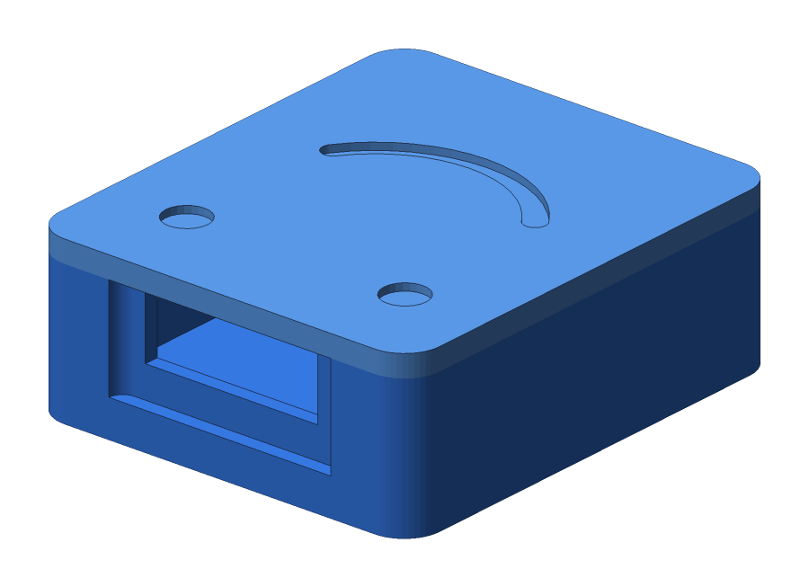
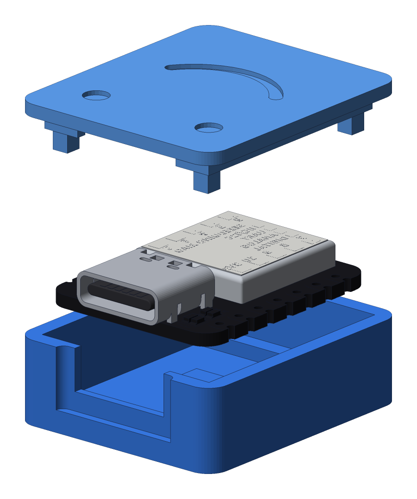
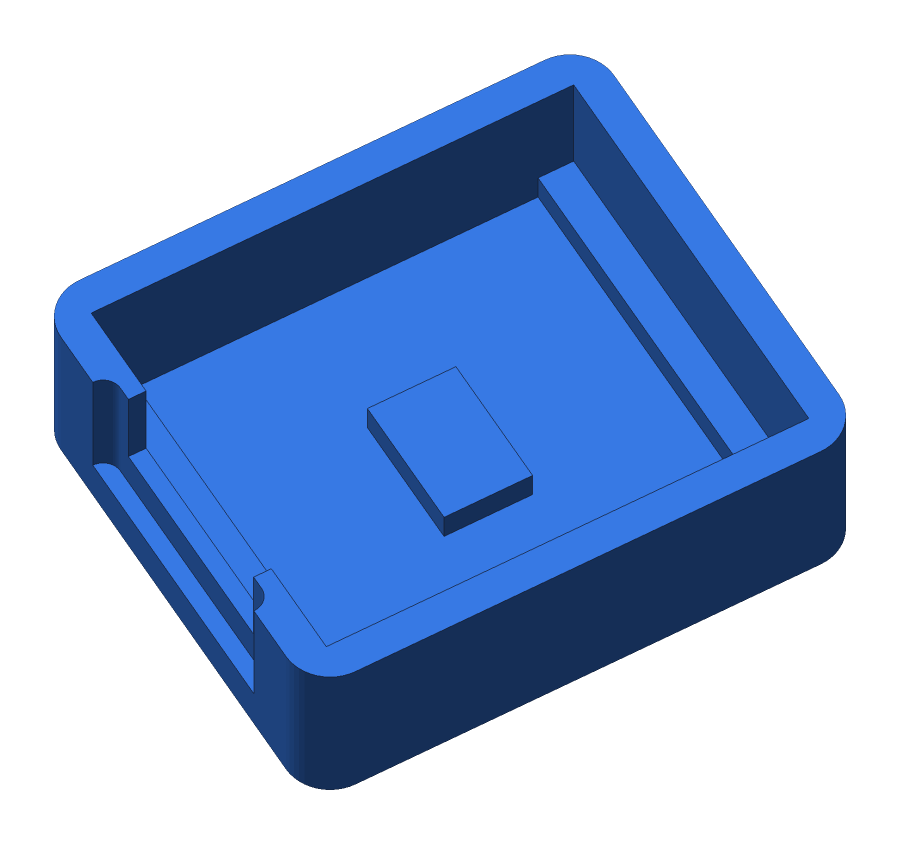
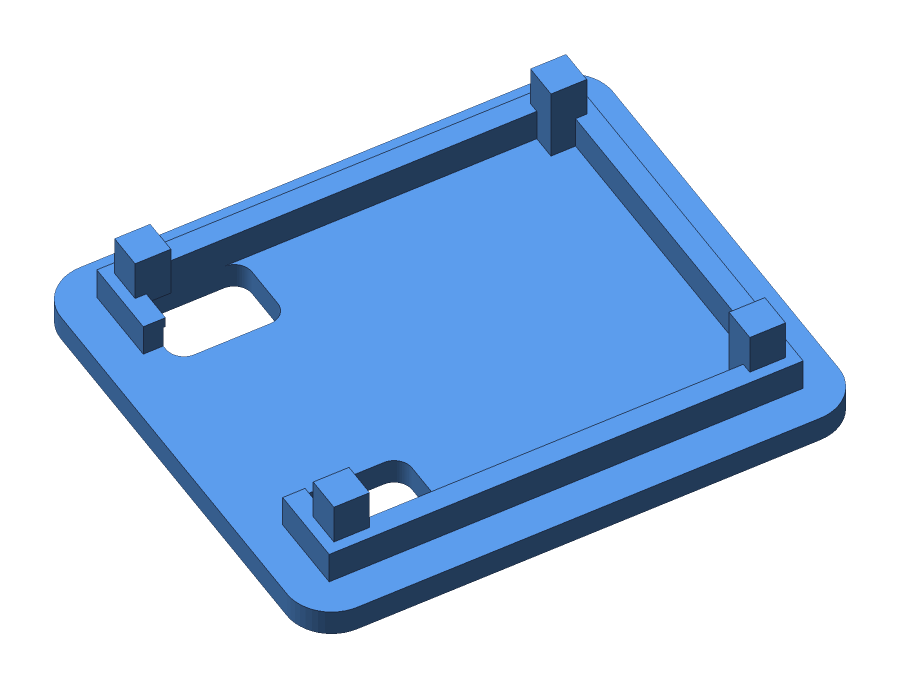
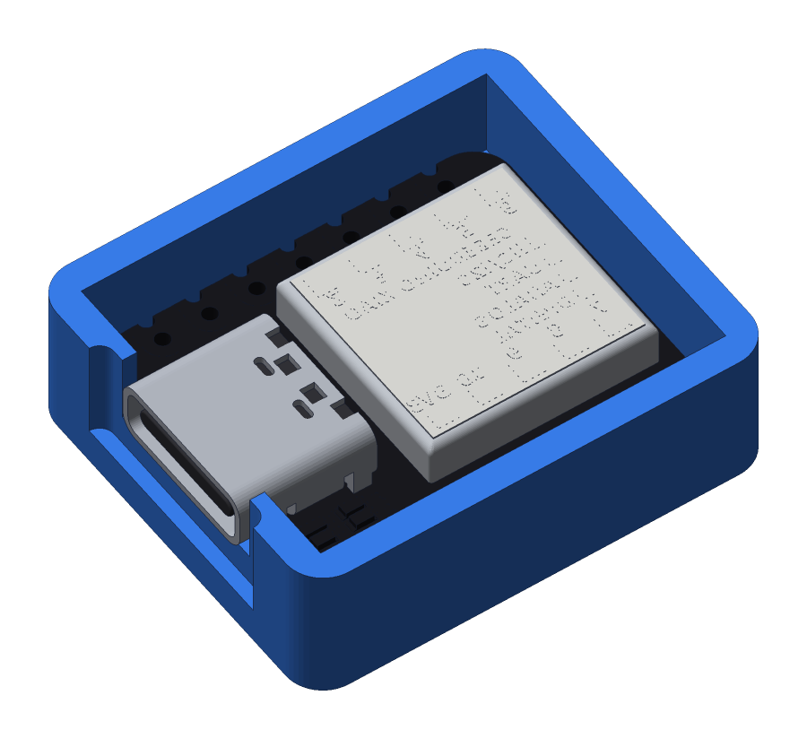
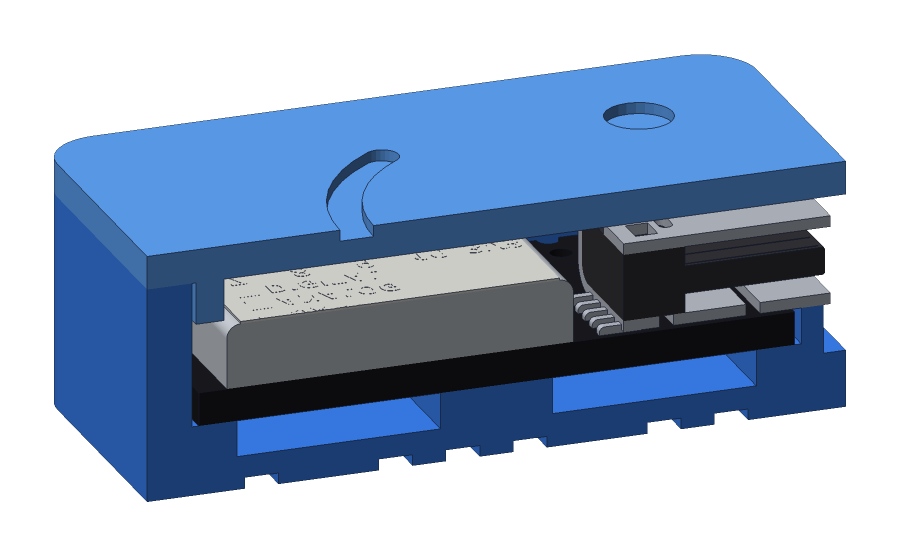

# Seeed Studio XIAO SAMD21 Case

Two-part case (base + snap-fit lid) for the
[Seeed Studio XIAO SAMD21](https://wiki.seeedstudio.com/Seeeduino-XIAO/).

- Outer size: **25.0 × 21.6 × 8.9 mm**
- Flat bottom: no floor slots for the male headers (set `HEADER_SLOTS = True` to cut them).
- USB-C opening with an outer recess for the cable overmold.



## Preview



| Base | Lid (underside) |
|---|---|
|  |  |

The board in these views is a simplified stand-in (PCB, USB-C and pin headers), not the real module.

## Board fit

The board sits on its pin headers, with the USB-C pointing out of the U opening. The case is 3.7 mm longer and wider than the board: 0.25 mm of clearance plus a 1.6 mm wall on each side.



Cross-section through the middle of the case (the front half is removed). The lid posts stop 0.2 mm above the PCB:



## Files

| File | Contents |
|---|---|
| `xiao_samd21_case.3mf` | Base and lid together on one plate (recommended) |
| `xiao_samd21_base.3mf` / `.stl` | Base only |
| `xiao_samd21_lid.3mf` / `.stl` | Lid only (already oriented, top face on the bed) |
| `xiao_samd21_case.py` | Parametric generator |
| `render_previews.py` | Renders the images in `images/` |

## Printing

The parts come already oriented: do not rotate them.

| Setting | Value |
|---|---|
| Material | PLA or PETG |
| Nozzle | 0.4 mm |
| Layer height | 0.2 mm (0.12–0.16 mm for a better fit) |
| Walls / perimeters | 3 |
| Top / bottom layers | 4 / 4 |
| Infill | 20 % (almost everything is solid wall) |
| Supports | **None** |
| Bed adhesion | Optional 3 mm brim on the lid (small footprint) |

Notes:

- The USB-C opening is a U open at the top; it needs no bridge or supports.
- With PETG, slow down outer walls to keep the fit tolerance.

## Assembly

1. Skip the male headers, or solder them only if `HEADER_SLOTS = True`.
2. Drop the board into the base from above, with the USB-C towards the U opening.
3. Press the lid on: the lip goes into the base and the 4 posts hold the PCB at the corners.

## Tuning

All dimensions are at the top of `xiao_samd21_case.py`. Measure the board with calipers before printing.

| Parameter | Default | When to change it |
|---|---|---|
| `LIP_CLR` | 0.15 | Lid too tight: 0.2. Lid too loose: 0.1 |
| `CLR` | 0.25 | Clearance between PCB and wall |
| `HEADERS` | `True` | `False` to lower the PCB (no header height) |
| `HEADER_SLOTS` | `False` | `True` to cut floor slots for male headers |
| `PCB_T` | 1.6 | Actual PCB thickness |
| `USB_OVERHANG` | 1.3 | How far the USB-C sticks out past the PCB |

## Regenerating the models

Requires [uv](https://docs.astral.sh/uv/). Dependencies (`manifold3d`, `numpy`) install automatically into `.venv`.

```
cd XIAO_SAMD21
uv run xiao_samd21_case.py
```

Overwrites every `.stl` and `.3mf` in the folder.

To refresh the preview images after changing parameters:

```
uv run render_previews.py
```

## LiveUse projects

This repository is one of four that make up LiveUse. LuLu is the device: a XIAO SAMD21 in the printed case, running the LiveUse firmware.

| Repository | Visibility | What it holds |
|---|---|---|
| [`liveuse`](https://github.com/yortyrh/liveuse) | Public | The macOS app (Tauri 2) and the website (Next.js). It reads `manifest.json` and `apps.json` from `liveuse-releases` and flashes LuLu |
| [`liveuse-firmware-xiao-samd21`](https://github.com/yortyrh/liveuse-firmware-xiao-samd21) | Private | Firmware source: USB HID mouse and keyboard driven by CDC serial commands. Its builds are published to `liveuse-releases` |
| [`liveuse-releases`](https://github.com/yortyrh/liveuse-releases) | Public | Firmware images and app installers, `manifest.json`, `apps.json`, and the firmware guide |
| [`xiao-samd21-case`](https://github.com/yortyrh/xiao-samd21-case) (this one) | Public | The LuLu case. The app and the website use its renders |

Hardware:

- Board: [Seeed Studio XIAO SAMD21 (Seeeduino XIAO)](https://wiki.seeedstudio.com/Seeeduino-XIAO/).
- Case: [`xiao-samd21-case` on Creality Cloud](https://www.crealitycloud.com/model-detail/xiao-samd21-case).

## License

[MIT](LICENSE)
