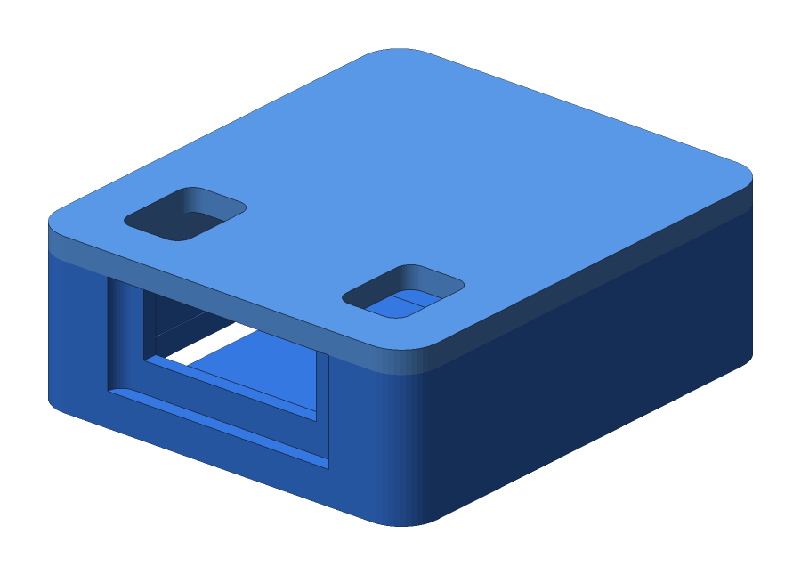
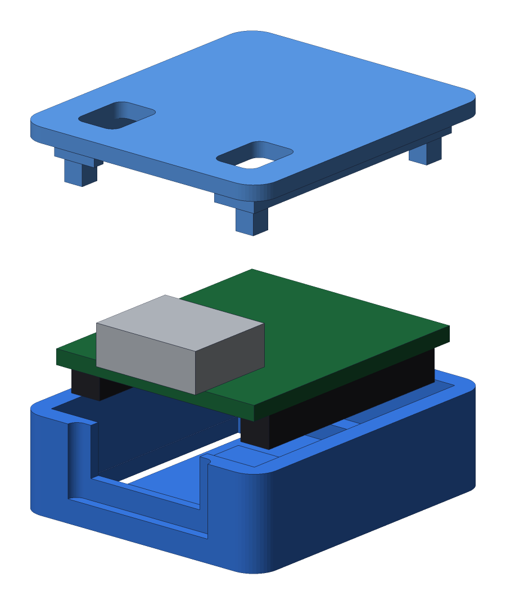
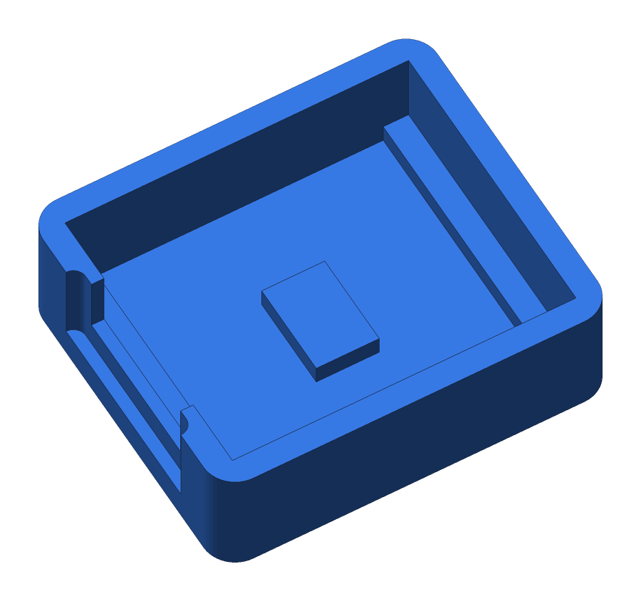
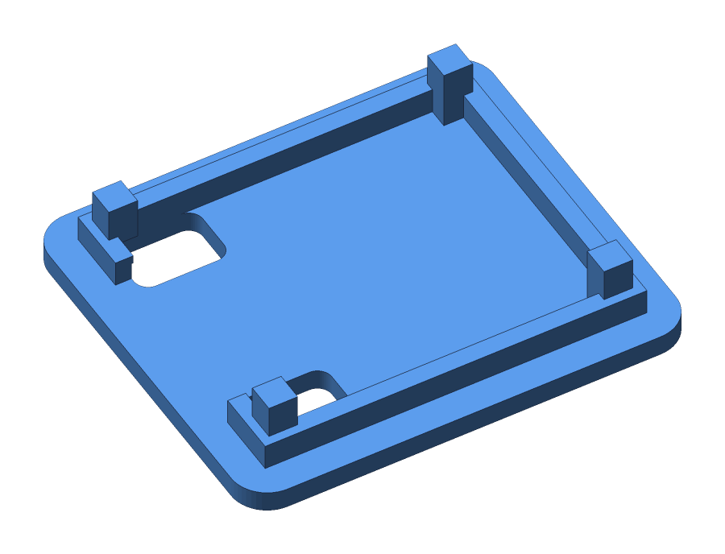
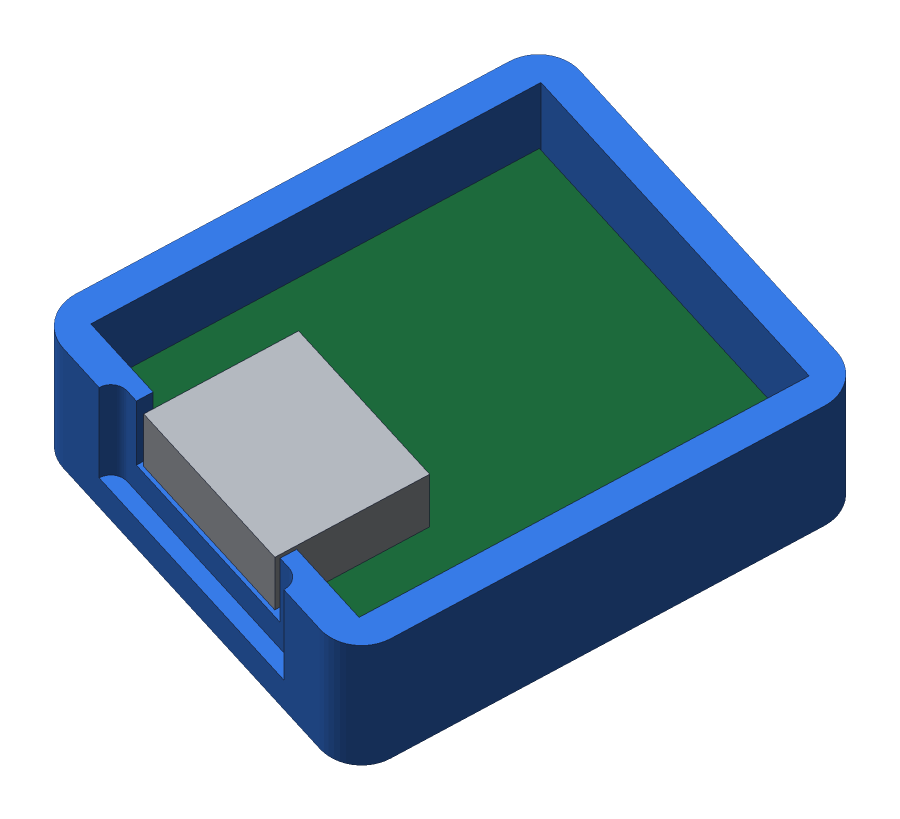
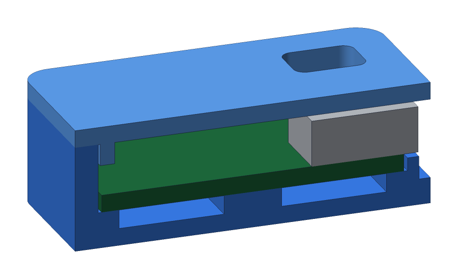

# Seeed Studio XIAO SAMD21 Case

Two-part case (base + snap-fit lid) for the
[Seeed Studio XIAO SAMD21](https://wiki.seeedstudio.com/Seeeduino-XIAO/).

- Outer size: **24.7 × 21.5 × 8.5 mm**
- Bottom slots for male headers: the case sits flush with the header plastic and plugs into a breadboard.
- USB-C opening with an outer recess for the cable overmold.
- Lid windows to see the LEDs and reach the RESET pads.



## Preview



| Base | Lid (underside) |
|---|---|
|  |  |

The board in these views is a simplified stand-in (PCB, USB-C and pin headers), not the real module.

## Board fit

The board sits on its pin headers, with the USB-C pointing out of the U opening. The case is 3.7 mm longer and wider than the board: 0.25 mm of clearance plus a 1.6 mm wall on each side.



Cross-section through the middle of the case (the front half is removed). The lid posts stop 0.2 mm above the PCB, and the lid window sits over the LED/RESET area:



## Files

| File | Contents |
|---|---|
| `xiao_samd21_case.3mf` | Base and lid together on one plate (recommended) |
| `xiao_samd21_base.3mf` / `.stl` | Base only |
| `xiao_samd21_lid.3mf` / `.stl` | Lid only (already oriented, top face on the bed) |
| `xiao_samd21_case.py` | Parametric generator |
| `render_previews.py` | Renders the images in `images/` |

## Printing

The parts come already oriented: do not rotate them.

| Setting | Value |
|---|---|
| Material | PLA or PETG |
| Nozzle | 0.4 mm |
| Layer height | 0.2 mm (0.12–0.16 mm for a better fit) |
| Walls / perimeters | 3 |
| Top / bottom layers | 4 / 4 |
| Infill | 20 % (almost everything is solid wall) |
| Supports | **None** |
| Bed adhesion | Optional 3 mm brim on the lid (small footprint) |

Notes:

- The USB-C opening is a U open at the top; it needs no bridge or supports.
- Disable ironing on the lid if the windows lose definition.
- With PETG, slow down outer walls to keep the fit tolerance.

## Assembly

1. Solder the male headers with the pins facing down (if `HEADERS = True`).
2. Drop the board into the base from above, with the USB-C towards the U opening.
3. Press the lid on: the lip goes into the base and the 4 posts hold the PCB at the corners.
4. To reset, short the pads through the window with tweezers.

## Tuning

All dimensions are at the top of `xiao_samd21_case.py`. Measure the board with calipers before printing.

| Parameter | Default | When to change it |
|---|---|---|
| `LIP_CLR` | 0.15 | Lid too tight: 0.2. Lid too loose: 0.1 |
| `CLR` | 0.25 | Clearance between PCB and wall |
| `HEADERS` | `True` | `False` for a closed bottom, no headers |
| `PCB_T` | 1.2 | Actual PCB thickness |
| `USB_OVERHANG` | 1.0 | How far the USB-C sticks out past the PCB |
| `WIN_Y`, `WIN_X_FROM_USB_END` | 6.2, 0.8 | Position of the LED/RESET windows |

## Regenerating the models

Requires [uv](https://docs.astral.sh/uv/). Dependencies (`manifold3d`, `numpy`) install automatically into `.venv`.

```
cd XIAO_SAMD21
uv run xiao_samd21_case.py
```

Overwrites every `.stl` and `.3mf` in the folder.

To refresh the preview images after changing parameters:

```
uv run render_previews.py
```

## License

[MIT](LICENSE)
